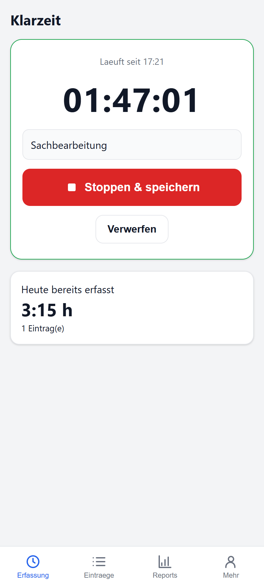
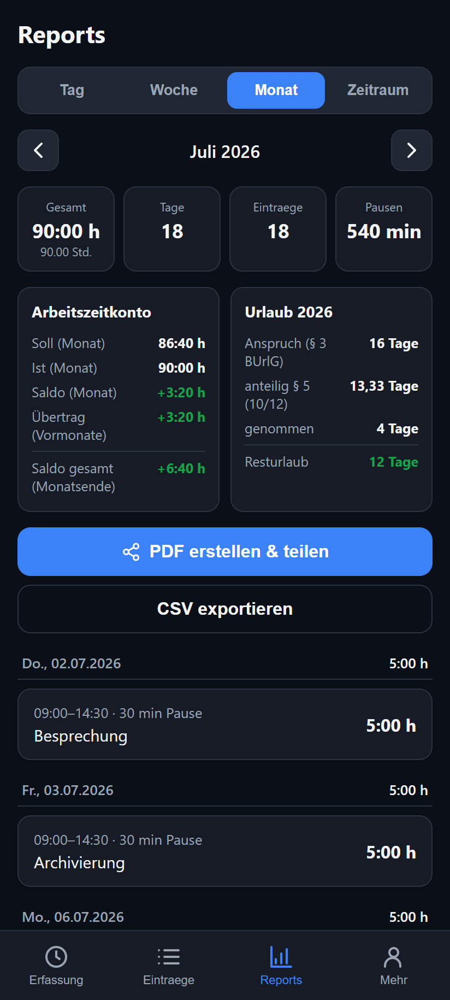

<div align="center">

# Klarzeit

**Your working hours. Your device. Nobody else.**

Offline time tracking for Android — with a working-time account and statutory
leave under German law.

[](LICENSE)
[](#installation)
[](https://react.dev)
[](https://www.typescriptlang.org)
[](https://capacitorjs.com)
[](https://claude.com/claude-code)

[Deutsch](README.md) · **English**

[Download APK](https://github.com/BosslandX/klarzeit-releases/releases/latest) · [Screenshots](#screenshots)

</div>

> **Heads-up:** The app's interface, its PDF output and all code comments are in
> **German**, and the leave calculation implements the *German* Federal Leave Act
> (Bundesurlaubsgesetz). This README is a summary for people browsing the
> repository — the app itself is not localised.

---

## What it is

A stopwatch for working hours that turns into a complete timesheet. Start, stop,
done — Klarzeit turns that into daily, weekly and monthly reports, keeps a
running working-time account (target vs. actual with carry-over) and calculates
statutory leave under the German Federal Leave Act.

No account, no sign-in, no server. Data lives in the app on the device and only
leaves it when *you* share a PDF, a CSV file or a backup — or when you switch on
the Clockodo transfer for an employment and trigger it yourself.

---

## Screenshots

<table>
<tr>
<td width="50%"></td>
<td width="50%"></td>
</tr>
<tr>
<td align="center"><b>Tracking in progress</b><br><sub>Survives app restarts</sub></td>
<td align="center"><b>Account &amp; leave</b><br><sub>Target/actual balance, statutory entitlement</sub></td>
</tr>
</table>

All screenshots show **made-up demo data**.

---

## Why

|  | Cloud tracker | Spreadsheet | **Klarzeit** |
|---|---|---|---|
| Account required | yes | – | **no** |
| Where data lives | someone's server | a file | **your device only**¹ |
| Recurring cost | usually monthly | – | **none** |
| Works offline | rarely | yes | **always** |
| Working-time account | sometimes | manual | **automatic, carried forward** |
| Statutory leave | rarely | manual | **calculated, with statute references** |
| Open source | rarely | – | **yes, MIT** |

¹ Unless you explicitly send entries to Clockodo — see [Privacy](#privacy).

---

## The interesting part

Most stopwatch apps stop at "hours per week". Klarzeit does the arithmetic that
German employment law actually requires:

```
Monthly target = weekly hours × 52 / 12
Annual leave   = 24 working days × working days per week / 6     (§ 3 BUrlG)
```

Plus the rules that bite in the first and last year of employment: the six-month
qualifying period (§ 4), twelfthing per full month of employment (§ 5 (1)), the
full entitlement when leaving in the second half of the year (§ 5 (1) lit. c),
and the rounding rule of § 5 (2) — which only ever rounds **up**: an entitlement
of 13.33 days stays 13.33 days, it is not rounded down to 13.

The logic lives in [`src/domain/employment.ts`](src/domain/employment.ts), is
free of UI and database code, and is covered by 68 tests that walk through the
statutes one by one.

If your contract grants more than the statutory minimum, you enter your annual
leave per employment. Klarzeit then works with that figure — never with less
than the statutory minimum — and applies the rules above to the whole
entitlement.

If your contract says that up to a certain number of overtime hours per month are
covered by your salary, you enter that number per employment as well. Klarzeit
deducts it month by month from the surplus, books only the rest to the working-time
account, and shows the covered hours as a separate line in the report and the PDF.
Each month stands on its own — a deficit from earlier months does not reduce it — and
the number is prorated in the first and last month of employment. The sentence below
the working-time account in the PDF, such as the clause of your contract that governs
overtime compensation, is also set per employment.

It does **not** handle public holidays, sick days, special rules a contract or
collective agreement sets for extra leave, additional leave for severe
disability (§ 208 SGB IX), or carry-over into the next calendar year. An entry counts entirely towards the day it starts on,
so night shifts are not split at midnight.

---

## Privacy

- No account, no sign-in, no user identifier.
- No analytics, no crash reporting, no ad IDs, no trackers.
- The only outbound connection the app makes on its own is the update check
  against this repository's GitHub releases — and you trigger it yourself.
- Optional, per employment: **transfer to Clockodo**. When you switch it on, the
  app sends that employment's entries (times, breaks as gaps, activity, customer,
  project, service) to your Clockodo account — only when you tap “An Clockodo
  uebertragen”. Tapping “Urlaub mit Clockodo abgleichen” sends the employment's open
  vacation periods as leave requests and reads back the status of your requests.
  The API key is kept encrypted in the Android KeyStore, excluded
  from Google backup and device transfer, and never part of a Klarzeit backup.
- PDF, CSV and backup leave the device only through the share sheet you operate.

Permissions: `INTERNET` (update check; Clockodo transfer if switched on), `WRITE_EXTERNAL_STORAGE` (automatic
backup, Android 10 and below only), `REQUEST_INSTALL_PACKAGES` (opens the system
installer for in-app updates — you confirm the install).

---

## Installation

Not on the Play Store. Grab the signed APK from
[Releases](https://github.com/BosslandX/klarzeit-releases/releases/latest), allow installation from this source when
Android asks, and install.

### Building it yourself

Requires Node 20+, JDK 21 and the Android SDK (set `sdk.dir` in
`android/local.properties`).

```bash
npm install
npm run dev      # web version in the browser
npm test         # domain tests
npm run build    # type-check + build
npm run apk      # debug APK
```

See the [German README](README.md#installation) for release signing and the
release process.

---

## Stack

Vite · React 19 · TypeScript · Capacitor 8 (Android) · Dexie (IndexedDB) ·
Capacitor Preferences · jsPDF + jspdf-autotable · date-fns · Vitest

---

## Disclaimer

The balances and leave entitlements Klarzeit produces are **not legal advice**
and come with no warranty. Your employment contract, any collective agreement
and the applicable statutes govern. Check your timesheet before submitting it.

---

## License & credits

[MIT](LICENSE) — Copyright © 2026 Zwetan Letschew.

Built by Zwetan Letschew, pair-programming with
**[Claude Code](https://claude.com/claude-code)** (Anthropic). Contributions by
Claude are marked `Co-Authored-By: Claude <noreply@anthropic.com>` in the commit
history.
