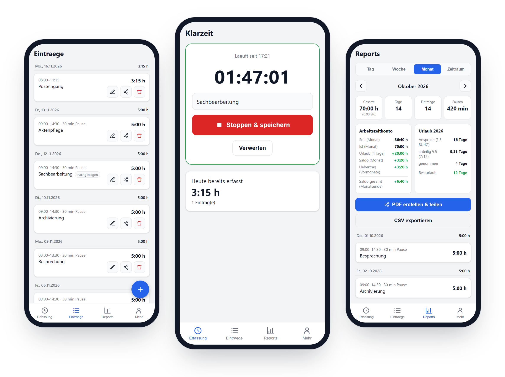
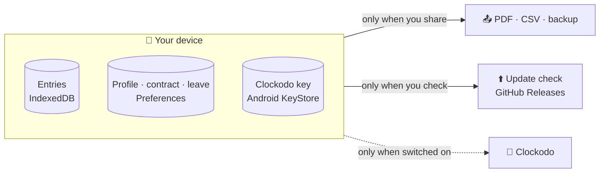

<p align="center">
  <picture>
    <source media="(prefers-color-scheme: dark)" srcset="assets/readme/banner-dark.svg">
    
  </picture>
</p>

<p align="center">
  <b>Time tracking for Android that works entirely offline.</b><br>
  Stopwatch, timesheet, working-time account and statutory leave under German law –<br>
  no account, no server, no trackers.
</p>

<p align="center">
  <a href="https://github.com/BosslandX/klarzeit-releases/releases/latest"></a>
</p>

<p align="center">
  
  
  <a href="LICENSE"></a>
  
  
  
  <a href="https://claude.com/claude-code"></a>
</p>

<p align="center">
  <a href="README.md">Deutsch</a> · <b>English</b>
</p>

<p align="center">
  <picture>
    <source media="(prefers-color-scheme: dark)" srcset="assets/screenshots/hero-dark.png">
    
  </picture>
  <br>
  <sub>All screenshots show made-up demo data.</sub>
</p>

> [!NOTE]
> The app's interface, its PDF output and all code comments are in **German**, and the
> leave calculation implements the German Federal Leave Act (Bundesurlaubsgesetz, BUrlG).
> This page is a summary for people browsing the repository – the app itself is not
> localised. The [German README](README.md) has the full details.

## What it does

<table>
<tr>
<td width="33%" valign="top">

**⏱️ Track**

Start, stop, done. The stopwatch keeps running when you close the app or restart the
phone. Add forgotten hours later – breaks with start and end time, night shifts into the
next day.

</td>
<td width="33%" valign="top">

**📊 Working-time account**

Target and actual hours per month, balance carried forward. Leave days count towards the
target; overtime that your salary already covers is deducted.

</td>
<td width="33%" valign="top">

**🏖️ Statutory leave**

Minimum leave, qualifying period, pro-rating and rounding as the BUrlG sets them – or the
leave in your contract, never below the statutory minimum.

</td>
</tr>
<tr>
<td width="33%" valign="top">

**💼 Several jobs**

Several employments side by side, each with its own contract, account, leave and
timesheet.

</td>
<td width="33%" valign="top">

**📄 PDF and CSV**

Timesheets for a single entry, day, week, month or any period, straight to the share
sheet. CSV with semicolons and decimal commas for German Excel.

</td>
<td width="33%" valign="top">

**🔄 Clockodo**

Send entries and leave requests to Clockodo – at the tap of a button or automatically,
with an eye on the editing lock. Optional, per employment.

</td>
</tr>
</table>

**Also:** backup as a file and automatically to the Documents folder, where it survives an
uninstall · updates from within the app · light and dark, following the system setting

## The arithmetic

Most stopwatch apps stop at "hours per week". Klarzeit does the arithmetic German
employment law actually needs:

```math
\text{target}_\text{month} = \text{weekly hours} \times \frac{52}{12}
\qquad
\text{balance}_\text{month} = \text{actual} + \text{leave credit} - \text{target}
```

```math
\text{annual leave} = 24 \times \frac{\text{working days per week}}{6}
```

The target is prorated by calendar days in the first and last month of employment. Each
leave day tops up to the daily target (weekly hours ÷ working days), so leave alone never
creates overtime. If your contract says that up to *n* overtime hours a month are covered
by your salary, Klarzeit deducts min(*n*, max(0, balance)) month by month – each month
stands on its own.

For leave, it applies the rules that bite in the first and last year of employment:

| Rule | Statute | What Klarzeit does |
|---|---|---|
| Minimum leave | § 3 (1) BUrlG | 24 working days on a six-day week, converted to your working days |
| Qualifying period | § 4 BUrlG | full entitlement only after six months |
| Pro-rating | § 5 (1) BUrlG | one twelfth per full month when the full entitlement does not arise |
| Leaving from July on | § 5 (1) (c) BUrlG, by inference | full annual leave instead of pro-rating, once the qualifying period is met |
| Rounding | § 5 (2) BUrlG | half a day or more rounds **up**; smaller fractions stay as they are |
| Contract leave | § 13 (1) BUrlG | your contractual figure applies, never below the statutory minimum |

§ 5 (2) only ever rounds up: an entitlement of 13.33 days stays 13.33 days, it is not
rounded down to 13. The logic lives in [`src/domain/employment.ts`](src/domain/employment.ts),
free of UI and database code, and is tested statute by statute.

It does **not** handle public holidays, sick days or other paid leave (they show up as
negative hours), half days of leave, carry-over into the next year (§ 7 (3) BUrlG),
additional leave for severe disability (§ 208 SGB IX), or overtime paid out. An entry
counts entirely towards the day it starts on.

## Clockodo, if you want it

If your employer uses [Clockodo](https://www.clockodo.com/de/), Klarzeit sends your entries
there – **one way only**, and only for employments where you switch it on.

```mermaid
gantt
    title One entry in Klarzeit becomes two entries in Clockodo
    dateFormat HH:mm
    axisFormat %H:%M
    section Klarzeit
        Working time  : 08:00, 16:30
        Break         : crit, 12:00, 12:30
    section Clockodo
        Segment 1     : active, 08:00, 12:00
        Segment 2     : active, 12:30, 16:30
```



- **One Clockodo entry per working segment** – Clockodo only knows breaks as gaps.
- **Corrections follow:** the next run replays edited and deleted entries.
- **At the tap of a button or automatically** – after saving or deleting an entry and when
  the app opens. Two runs for the same employment never overlap.
- **Editing lock:** Klarzeit reads your account's lock period and warns on the last day
  Clockodo still accepts an entry, and the day before.
- **Leave requests:** request open leave days at the tap of a button, consecutive days as
  one request; each day then shows its status, and a request can be withdrawn.
- **The API key** is kept encrypted in the Android KeyStore – never in a backup, never in
  Google's device backup or device transfer.

## Privacy



- No account, no sign-in, no user identifier.
- No analytics, no crash reporting, no ad IDs, no trackers.
- The app never goes online on its own – except to Clockodo, if you switch on automatic
  transfer for an employment.
- The automatic backup stays on the device, in `Documents/Klarzeit/`.

Permissions: `INTERNET` (update check and Clockodo), `WRITE_EXTERNAL_STORAGE` (automatic
backup, Android 10 and below only), `REQUEST_INSTALL_PACKAGES` (opens the system installer
for in-app updates – you confirm the install).

## Installation

Not on the Play Store. Grab the signed APK from
[Releases](https://github.com/BosslandX/klarzeit-releases/releases/latest), allow
installation from this source when Android asks, and install. From then on the app checks
for new versions at the tap of a button (tab *Mehr* → *App-Update*). Versions before 1.5.1
look for updates in a place they can no longer reach – install the current one by hand once.

## Under the hood

Vite · React 19 · TypeScript 5.9 · Capacitor 8 (Android) · Dexie (IndexedDB) · Capacitor
Preferences · jsPDF + jspdf-autotable · date-fns · Vitest – **287 tests in 22 files**
(as of 1.12.0).

Two rules hold it together: **`domain/` is pure** (no database, no React, no Capacitor –
which is why the legal arithmetic is testable), and **`db/` is the only place that reads or
writes data**, with one exception: the Clockodo key, which `clockodo/key-store.ts` keeps in
the Android KeyStore.

```bash
npm install
npm run dev      # web version in the browser
npm test         # Vitest
npm run build    # type-check + build
npm run apk      # debug APK
```

Requires Node 20.19+ or 22.12+, JDK 21 and the Android SDK (`sdk.dir` in
`android/local.properties`). Release signing, publishing a version and regenerating the
screenshots are described in the [German README](README.md#unter-der-haube).

## Disclaimer

The balances and leave entitlements Klarzeit produces are **not legal advice** and come with
no warranty. Your employment contract, any collective agreement and the applicable statutes
govern. Check your timesheet before submitting it, and use the backup.

## License & credits

[MIT](LICENSE) – Copyright © 2026 Zwetan Letschew.

Built by Zwetan Letschew, pair-programming with
**[Claude Code](https://claude.com/claude-code)** (Anthropic).
Standing on [React](https://react.dev) · [Vite](https://vite.dev) ·
[Capacitor](https://capacitorjs.com) · [Dexie](https://dexie.org) ·
[jsPDF](https://github.com/parallax/jsPDF) ·
[jspdf-autotable](https://github.com/simonbengtsson/jsPDF-AutoTable) ·
[date-fns](https://date-fns.org)
