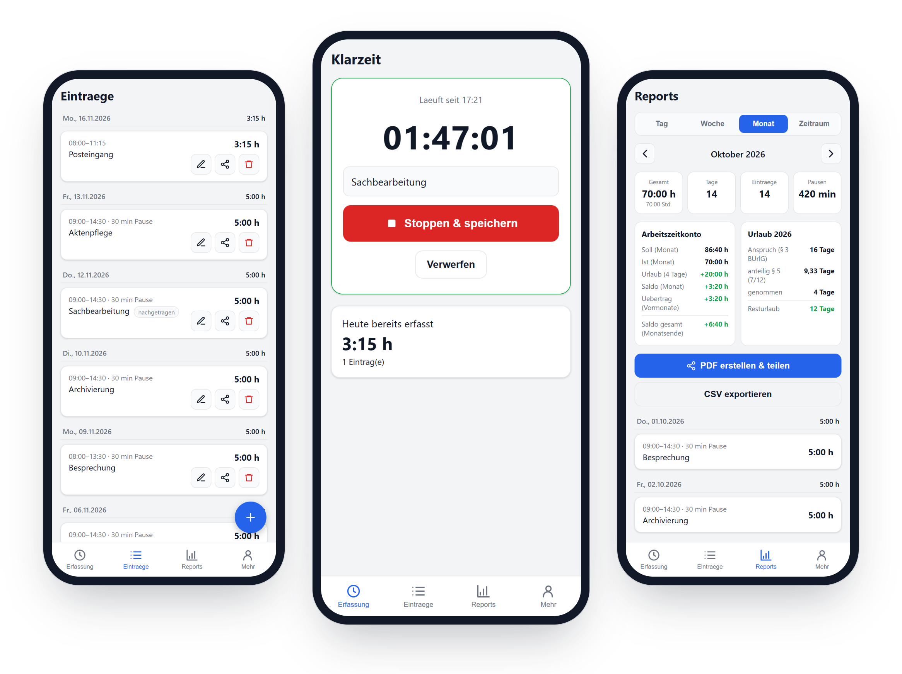
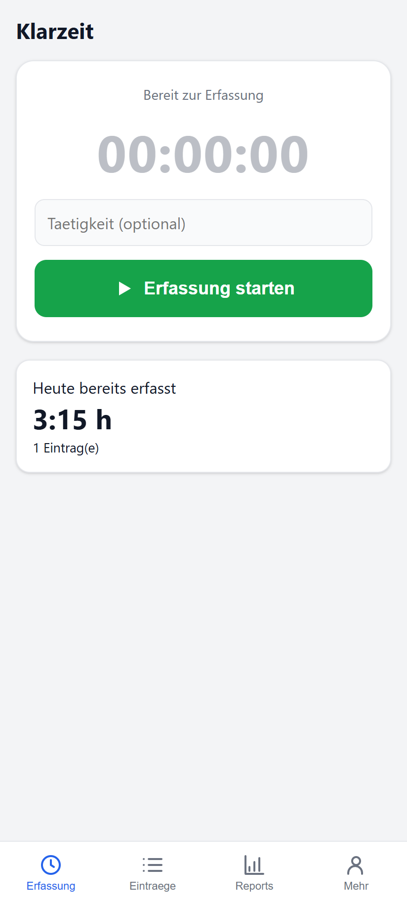
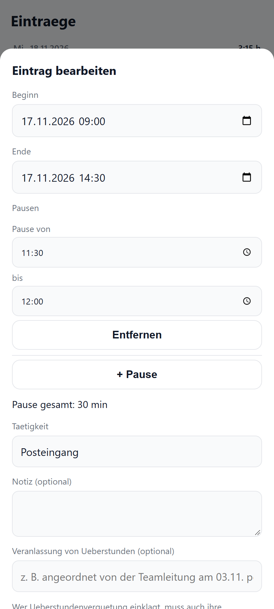
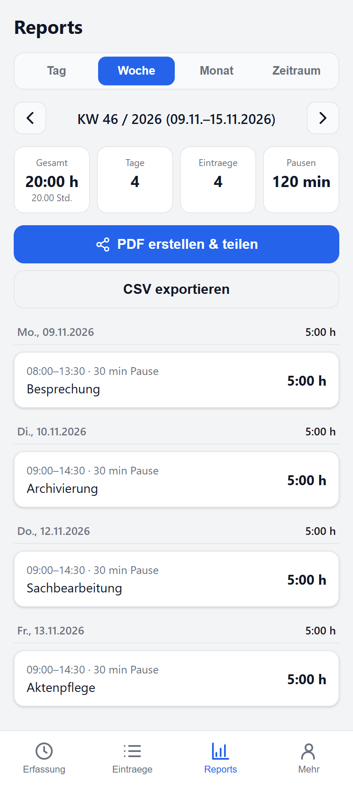
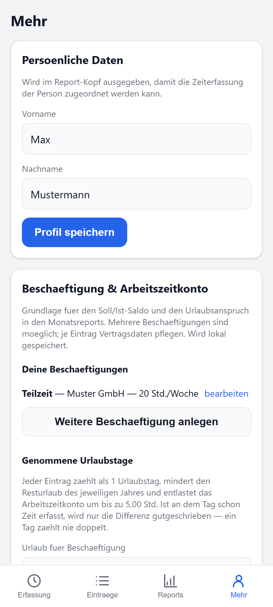
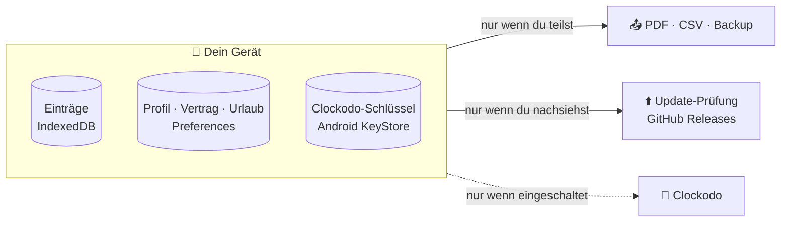
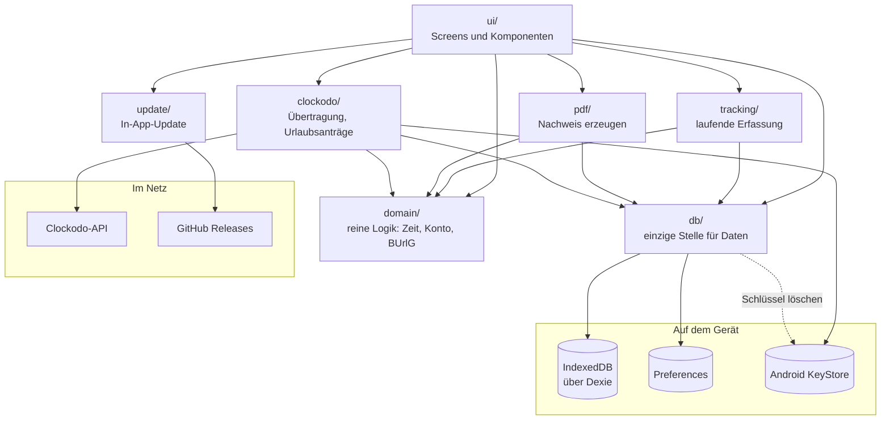

<!--
  Banner: assets/readme/banner-{light,dark}.svg – von Hand gebaut, per CSS animiert, ohne Skript.
  Titelbild und Screenshots: node tools/screenshots.mjs (Anleitung im Kopf der Datei).
  Sobald das Logo vorliegt, ersetzt es die Uhr im Banner.
-->

<p align="center">
  <picture>
    <source media="(prefers-color-scheme: dark)" srcset="assets/readme/banner-dark.svg">
    
  </picture>
</p>

<p align="center">
  <b>Arbeitszeiterfassung für Android, die komplett offline arbeitet.</b><br>
  Stoppuhr, Stundennachweis, Arbeitszeitkonto und gesetzlicher Urlaub nach BUrlG –<br>
  ohne Konto, ohne Server, ohne Tracker.
</p>

<p align="center">
  <a href="https://github.com/BosslandX/klarzeit-releases/releases/latest"></a>
</p>

<p align="center">
  
  
  <a href="LICENSE"></a>
  
  
  
  <a href="#wie-klarzeit-entstanden-ist"></a>
</p>

<p align="center">
  <a href="#was-klarzeit-kann">Funktionen</a> ·
  <a href="#arbeitszeitkonto--urlaub">Konto &amp; Urlaub</a> ·
  <a href="#clockodo-wenn-du-willst">Clockodo</a> ·
  <a href="#datenschutz">Datenschutz</a> ·
  <a href="#installation">Installation</a> ·
  <a href="#unter-der-haube">Unter der Haube</a> ·
  <a href="README.en.md">English</a>
</p>

<p align="center">
  <picture>
    <source media="(prefers-color-scheme: dark)" srcset="assets/screenshots/hero-dark.png">
    
  </picture>
  <br>
  <sub>Alle Aufnahmen zeigen erfundene Demo-Daten.</sub>
</p>

## Was Klarzeit kann

<table>
<tr>
<td width="33%" valign="top">

**⏱️ Erfassen**

Start, Stopp, fertig. Die Stoppuhr läuft weiter, auch wenn du die App schließt
oder das Handy neu startest. Vergessenes trägst du nach – Pausen mit Uhrzeit,
Nachtschichten mit Folgetag.

</td>
<td width="33%" valign="top">

**📊 Arbeitszeitkonto**

Soll und Ist je Monat, Saldo mit Übertrag. Urlaub entlastet das Konto,
mit dem Gehalt abgegoltene Überstunden zieht es ab.

</td>
<td width="33%" valign="top">

**🏖️ Urlaub nach BUrlG**

Mindesturlaub, Wartezeit, Zwölftelung und Rundung nach Gesetz – oder dein
Vertragsurlaub, aber nie weniger als das Minimum.

</td>
</tr>
<tr>
<td width="33%" valign="top">

**💼 Mehrere Jobs**

Mehrere Beschäftigungen nebeneinander, jede mit eigenem Vertrag,
Konto, Urlaub und Nachweis.

</td>
<td width="33%" valign="top">

**📄 PDF und CSV**

Stundennachweis für einen Eintrag, Tag, Woche, Monat oder freien Zeitraum,
direkt ins Teilen-Menü. CSV mit Semikolon und Dezimalkomma für Excel.

</td>
<td width="33%" valign="top">

**🔄 Clockodo**

Einträge und Urlaubsanträge an Clockodo übertragen – auf Knopfdruck oder
automatisch, mit Blick auf die Sperrfrist. Optional, je Beschäftigung.

</td>
</tr>
</table>

**Außerdem:** Backup als Datei und automatisch in den Documents-Ordner, wo es eine
Deinstallation übersteht · Update direkt aus der App · hell und dunkel nach Systemeinstellung

<details>
<summary><b>Weitere Ansichten</b></summary>
<br>

<table>
<tr>
<td align="center" width="25%"><picture><source media="(prefers-color-scheme: dark)" srcset="assets/screenshots/home-dark.png"></picture><br><sub><b>Erfassung</b></sub></td>
<td align="center" width="25%"><picture><source media="(prefers-color-scheme: dark)" srcset="assets/screenshots/form-dark.png"></picture><br><sub><b>Pausen mit Uhrzeit</b></sub></td>
<td align="center" width="25%"><picture><source media="(prefers-color-scheme: dark)" srcset="assets/screenshots/reports-dark.png"></picture><br><sub><b>Wochenbericht</b></sub></td>
<td align="center" width="25%"><picture><source media="(prefers-color-scheme: dark)" srcset="assets/screenshots/more-dark.png"></picture><br><sub><b>Beschäftigungen</b></sub></td>
</tr>
</table>

Die Bilder folgen deinem GitHub-Design, hell oder dunkel. Sie entstehen mit
`node tools/screenshots.mjs` aus der Web-Version im Handyformat (412 × 915, doppelte
Pixeldichte) – am Schreibtisch, nicht auf dem Telefon; Systemleiste und Safe-Area fehlen.

</details>

## Arbeitszeitkonto & Urlaub

Das ist der Teil, den die meisten Stoppuhr-Apps auslassen. Klarzeit rechnet ihn aus –
und zeigt die Grundlage dazu.

### Das Konto

```math
\text{Soll}_\text{Monat} = \text{Wochenstunden} \times \frac{52}{12}
\qquad
\text{Saldo}_\text{Monat} = \text{Ist} + \text{Urlaubsgutschrift} - \text{Soll}
```

- **Soll** – im Eintritts- und Austrittsmonat anteilig nach Kalendertagen.
- **Ist** – erfasste Zeit abzüglich Pausen, begrenzt auf den Beschäftigungszeitraum.
- **Urlaubsgutschrift** – jeder Urlaubstag füllt bis zum Tagessoll auf
  (Wochenstunden ÷ Arbeitstage). Wer an dem Tag doch gearbeitet hat, bekommt nur die
  Differenz; reiner Urlaub erzeugt nie Überstunden.
- **Übertrag** – der Saldo wird Monat für Monat fortgeschrieben.

Ein Monat mit 20 Wochenstunden an vier Tagen und vier Urlaubstagen:

| Soll | Ist | Urlaub | Saldo |
|---:|---:|---:|---:|
| 86:40 | 70:00 | +20:00 | **+3:20** |

**Mit dem Gehalt abgegoltene Überstunden.** Steht im Vertrag, dass bis zu *n*
Überstunden im Monat mit dem Gehalt abgegolten sind, trägst du *n* je Beschäftigung ein:

```math
\text{abgegolten}_\text{Monat} = \min\bigl(n,\ \max(0,\ \text{Saldo}_\text{Monat})\bigr)
```

Jeder Monat zählt für sich – Minusstunden aus Vormonaten mindern die Abgeltung nicht. Im
Eintritts- und Austrittsmonat gilt *n* anteilig wie das Soll. Auswertung und Monats-PDF
zeigen die abgegoltenen Stunden als eigene Zeile; den Hinweis unter dem Konto im PDF,
etwa die Ausgleichsregel deines Vertrags, trägst du je Beschäftigung selbst ein.

### Der Urlaub

```math
\text{Jahresurlaub} = 24 \times \frac{\text{Arbeitstage pro Woche}}{6}
```

Bei vier Arbeitstagen sind das 16 Tage. Dazu kommen die Regeln für das Eintritts- und
das Austrittsjahr:

| Regel | Fundstelle | Was Klarzeit tut |
|---|---|---|
| Mindesturlaub | § 3 Abs. 1 BUrlG | 24 Werktage, umgerechnet von der Sechs-Tage-Woche auf deine Arbeitstage |
| Wartezeit | § 4 BUrlG | voller Anspruch erst nach sechs Monaten |
| Zwölftelung | § 5 Abs. 1 BUrlG | ein Zwölftel je vollem Monat, wenn der volle Anspruch nicht entsteht |
| Austritt ab Juli | § 5 Abs. 1 lit. c BUrlG, Umkehrschluss | nach erfüllter Wartezeit voller Jahresurlaub statt Zwölftelung |
| Rundung | § 5 Abs. 2 BUrlG | ab einem halben Tag **auf**runden, kleinere Bruchteile bleiben stehen |
| Vertragsurlaub | § 13 Abs. 1 BUrlG | dein Vertragswert gilt, aber nie unter dem gesetzlichen Minimum |

> [!NOTE]
> Die Rundung wird am häufigsten falsch gemacht: § 5 Abs. 2 BUrlG kennt nur das
> Aufrunden. 13,33 Tage bleiben 13,33 Tage – auf 13 abgerundet wird nicht.

Die ganze Rechnung steht in [`src/domain/employment.ts`](src/domain/employment.ts),
frei von Oberfläche und Datenbank, und ist in
[`employment.test.ts`](src/domain/employment.test.ts) Paragraph für Paragraph getestet.
Gesetzestext: [Bundesurlaubsgesetz](https://www.gesetze-im-internet.de/burlg/).

<details>
<summary><b>Was Klarzeit nicht rechnet</b></summary>
<br>

- **Feiertage, Krankheit und sonstige bezahlte Freistellung** kennt die App nicht – sie
  erscheinen als Minusstunden.
- **Keine halben Urlaubstage.** Jeder eingetragene Urlaubstag zählt als ganzer Tag.
- **Kein Übertrag ins Folgejahr** (§ 7 Abs. 3 BUrlG). Der Resturlaub gilt je Kalenderjahr.
- **Kein Zusatzurlaub für schwerbehinderte Menschen** (§ 208 SGB IX).
- **Keine eigenen Regeln für Mehrurlaub.** Regelt dein Vertrag ihn eigens, weicht die
  Anzeige im Eintritts- und Austrittsjahr ab.
- **Keine Teilung um Mitternacht.** Ein Eintrag zählt ganz zu dem Tag, an dem er beginnt.
- **Ausgezahlte Überstunden** lassen sich nicht buchen; das Konto führt sie als Guthaben.

</details>

## Clockodo, wenn du willst

Für alle, deren Arbeitgeber mit [Clockodo](https://www.clockodo.com/de/) arbeitet:
Klarzeit überträgt dorthin – **nur in diese Richtung**, und nur für Beschäftigungen, bei
denen du es einschaltest.

```mermaid
gantt
    title Ein Eintrag in Klarzeit wird zu zwei Einträgen in Clockodo
    dateFormat HH:mm
    axisFormat %H:%M
    section Klarzeit
        Arbeitszeit  : 08:00, 16:30
        Pause        : crit, 12:00, 12:30
    section Clockodo
        Abschnitt 1  : active, 08:00, 12:00
        Abschnitt 2  : active, 12:30, 16:30
```



- **Je Arbeitsabschnitt ein Eintrag.** Clockodo kennt Pausen nur als Lücke. Kunde,
  Leistung und, wenn nötig, ein Projekt wählst du im Eintrag.
- **Korrekturen gehen mit.** Geänderte und gelöschte Einträge zieht der nächste Lauf nach,
  auch wenn ein Eintrag die Beschäftigung wechselt.
- **Auf Knopfdruck oder automatisch** – nach dem Speichern oder Löschen und beim Öffnen der
  App. Zwei Läufe derselben Beschäftigung laufen nie gleichzeitig, damit nichts doppelt
  gebucht wird.
- **Sperrfrist im Blick.** Klarzeit liest die Sperrfrist deines Clockodo-Kontos und warnt am
  Vortag und am letzten Tag, an dem Clockodo einen Eintrag noch annimmt.
- **Urlaubsanträge.** Offene Urlaubstage beantragst du per Knopf, zusammenhängende Tage als
  einen Antrag. Danach steht an jedem Tag der Stand: beantragt, genehmigt, abgelehnt. Einen
  falsch gestellten Antrag ziehst du per Knopf zurück.
- **Der API-Schlüssel** liegt verschlüsselt im Android-Schlüsselspeicher (KeyStore) – nicht
  im Backup, nicht in der Google-Sicherung, nicht beim Geräteumzug.

## Datenschutz

Klarzeit verarbeitet Arbeitszeiten und Personendaten – und behält beides auf dem Gerät.



- **Kein Konto, keine Anmeldung, keine Nutzerkennung.**
- **Kein Analytics, kein Crash-Reporting, keine Werbe-IDs, keine Tracker.**
- **Von sich aus geht die App nicht ins Netz** – mit einer Ausnahme: Hast du bei einer
  Beschäftigung das automatische Übertragen eingeschaltet, spricht sie mit Clockodo.
- **Das automatische Backup bleibt auf dem Gerät**, im Ordner `Documents/Klarzeit/`.

<details>
<summary><b>Warum die App diese Berechtigungen will</b></summary>
<br>

| Berechtigung | Wofür | Wann |
|---|---|---|
| `INTERNET` | Update-Prüfung und Download der neuen APK; Clockodo | nur auf Knopfdruck – oder automatisch zu Clockodo, wenn du es einschaltest |
| `WRITE_EXTERNAL_STORAGE` | automatisches Backup nach `Documents/Klarzeit/` | nur bis Android 10 (`maxSdkVersion=29`); ab Android 11 ohne Berechtigung |
| `REQUEST_INSTALL_PACKAGES` | Start des System-Installers für das In-App-Update | öffnet nur den Android-Dialog, installieren musst du selbst bestätigen |

</details>

## Installation

Klarzeit gibt es nicht im Play Store, sondern als signierte APK:

1. **[Neueste Version herunterladen](https://github.com/BosslandX/klarzeit-releases/releases/latest)**
   (`klarzeit-<version>-release.apk`).
2. Android fragt nach der Erlaubnis, Apps aus dieser Quelle zu installieren – bestätigen.
3. Installieren, fertig. Nach neuen Versionen sieht die App auf Knopfdruck selbst nach
   (Tab *Mehr* → *App-Update*) und installiert sie direkt.

> [!TIP]
> Versionen vor 1.5.1 suchen Updates an einer Stelle, die sie nicht mehr erreichen. Wer so
> eine Version hat, installiert die aktuelle einmal von Hand. Wer von der Vorgänger-App mit
> anderer App-ID kommt, exportiert dort ein Backup und importiert es in Klarzeit – das
> Format ist kompatibel geblieben.

## Unter der Haube

**Vite** · **React 19** · **TypeScript 5.9** · **Capacitor 8** (Android) · **Dexie**
(IndexedDB) · Capacitor Preferences · jsPDF + jspdf-autotable · date-fns · Vitest



Zwei Regeln halten das zusammen:

1. **`domain/` ist rein.** Keine Datenbank, kein React, keine Capacitor-Aufrufe – nur
   Funktionen über Werten. Deshalb ist die Rechtsmathematik testbar.
2. **`db/` ist die einzige Stelle, die Daten liest oder schreibt** – mit einer Ausnahme:
   Den Clockodo-Schlüssel verwahrt `clockodo/key-store.ts` im Android KeyStore. Zeiten
   immer als Epoch-Millisekunden; formatiert wird nur in `domain/time.ts`.

Dazu **287 Tests in 22 Dateien** (Stand 1.12.0, `npm test`).

<details>
<summary><b>Verzeichnisse</b></summary>
<br>

```
src/
  domain/     types · time · aggregate · breaks · entry-dates
              employment (Arbeitszeitkonto + BUrlG)
              clockodo · clockodo-transfer · clockodo-absence · clockodo-lock
  db/         db (Dexie) · entries · profile · running · employment
              backup · auto-backup · clockodo-lists · clockodo-deletes · clockodo-lock
  clockodo/   client · transfer · vacation-transfer · auto-transfer · lock · key-store
  tracking/   useTracker (laufende Erfassung)
  pdf/        report-pdf (jsPDF) · share (Filesystem + Share)
  update/     updater (Releases über CapacitorHttp)
  ui/         App · styles.css
              components/  BottomNav · EntryFormModal · ClockodoSettings
                           VacationClockodo · VacationDayRow · Icons
              screens/     Home · Entries · Reports · More
android/      Capacitor-Projekt mit nativem ApkInstaller-Plugin
assets/       Icon-Quellen · readme/ (Banner) · screenshots/
tools/        gen-icons · optimize-png · gradle · screenshots · Werkzeuge der Auftragskette
auftraege/    Aufträge der Auftragskette (siehe CLAUDE.md)
```

</details>

<details>
<summary><b>Selbst bauen</b></summary>
<br>

**Voraussetzungen:** Node 20.19+ oder 22.12+, JDK 21 (`JAVA_HOME` gesetzt), Android SDK.
Den SDK-Pfad in `android/local.properties` eintragen:

```properties
sdk.dir=/pfad/zum/Android/Sdk
```

```bash
npm install
npm run dev          # Web-Version im Browser (Daten in IndexedDB)
npm test             # Vitest
npm run build        # TypeScript-Prüfung + Vite-Build nach dist/
npm run apk          # Debug-APK
```

Ergebnis: `android/app/build/outputs/apk/debug/klarzeit-<version>-debug.apk`

**Signierte Release-APK.** Das Signing liest seine Zugangsdaten aus der gitignorierten
`android/keystore.properties`; fehlt sie, wird unsigniert gebaut statt abgebrochen.

```bash
keytool -genkeypair -v -keystore android/klarzeit-release.keystore \
  -alias klarzeit -keyalg RSA -keysize 2048 -validity 10000
cp android/keystore.properties.example android/keystore.properties
# Werte eintragen, dann:
npm run apk:release
```

> [!WARNING]
> Keystore und Passwort sicher aufbewahren. Ohne beide lässt sich die App nicht mehr mit
> derselben Signatur aktualisieren – alle müssten neu installieren.

**Icons und Splash** entstehen aus `assets/source-logo.png` mit `npm run icons`.

**Screenshots und Titelbild** neu erzeugen:

```bash
npm run dev -- --port 5199 --strictPort    # Terminal A
node tools/screenshots.mjs                 # Terminal B
```

</details>

<details>
<summary><b>Eine neue Version veröffentlichen</b></summary>
<br>

1. `versionCode` (aufsteigend) und `versionName` in `android/app/build.gradle` setzen, dazu
   `version` in `package.json` – daraus liest die App ihre Versionsanzeige.
2. `npm test && npm run build`, dann `npm run apk:release`.
3. Signatur prüfen: `apksigner verify --print-certs <apk>`.
4. `version.json` schreiben. `versionCode` muss zur `build.gradle` passen, `url` ist die
   Tag-URL mit dem versionierten Dateinamen:

   ```json
   {
     "versionCode": 16,
     "versionName": "1.12.0",
     "url": "https://github.com/BosslandX/klarzeit-releases/releases/download/v1.12.0/klarzeit-1.12.0-release.apk",
     "notes": "Was neu ist"
   }
   ```

5. Release im öffentlichen Release-Repo anlegen und beide Dateien anhängen:

   ```bash
   gh release create v1.12.0 -R BosslandX/klarzeit-releases \
     --title "Klarzeit 1.12.0" --notes "Was neu ist" \
     klarzeit-1.12.0-release.apk version.json
   ```

Der Updater liest `releases/latest/download/version.json` aus
[`BosslandX/klarzeit-releases`](https://github.com/BosslandX/klarzeit-releases), einem
öffentlichen Repo nur mit Releases. Er fragt über `CapacitorHttp` ab, nicht über `fetch`:
Der Asset-Server von GitHub sendet keine CORS-Header. Android installiert ein Update nur,
wenn App-ID **und** Signatur übereinstimmen.

</details>

## Versionen

| Version | Datum | Neu |
|---|---|---|
| **1.12.1** | 17.11.2026 | Sicherheitsupdate: PDF-Bibliothek und Capacitor aktualisiert |
| 1.12.0 | 22.10.2026 | Ende folgt dem Beginn; Pausen nur noch als Uhrzeit |
| 1.11.0 | 10.10.2026 | Clockodo-Sperrfrist; automatisch übertragen |
| 1.10.0 | 10.10.2026 | Korrekturen erreichen Clockodo; Urlaubsantrag zurückziehen |
| 1.9.0 | 01.10.2026 | Urlaubsanträge an Clockodo |
| 1.8.1 | 01.10.2026 | Urlaub am selben Tag in zwei Beschäftigungen |
| 1.8.0 | 30.09.2026 | Abgegoltene Überstunden; Kontohinweis im PDF |
| 1.7.0 | 25.09.2026 | Pausen mit Uhrzeit; Übertragung an Clockodo |
| 1.6.1 | 24.09.2026 | Backup-Import „Zusammenführen“ übernimmt Stammdaten |
| 1.6.0 | 24.09.2026 | Vertraglicher Urlaub |
| 1.5.1 | 23.09.2026 | Mehrere Beschäftigungen; Backup-Format 3; eigener Update-Kanal |

<details>
<summary><b>Ältere Versionen</b></summary>
<br>

| Version | Datum | Neu |
|---|---|---|
| 1.4 | 28.08.2026 | Urlaub entlastet das Konto; Urlaub als Zeitraum eintragen; Backup-Zusammenführen repariert |
| 1.3 | 09.08.2026 | Erste Veröffentlichung als quelloffenes Projekt unter dem Namen Klarzeit, MIT-Lizenz |
| 1.2 | – | Arbeitszeitkonto und gesetzlicher Urlaub in Monatsbericht und Monats-PDF |
| 1.1 | – | Automatisches Backup, In-App-Update, Icon und Splash-Screen |
| 1.0 | – | Erfassung mit Stoppuhr, Nachtragen, Berichte, PDF- und CSV-Export, Backup |

Die Versionen 1.0 bis 1.2 entstanden als Vorgänger-App; die Git-Geschichte beginnt mit 1.3.
Die Einzelheiten ab 1.5.1 stehen in den
[Release-Notizen](https://github.com/BosslandX/klarzeit-releases/releases).

</details>

## Wie Klarzeit entstanden ist

Klarzeit ist im Pair-Programming mit **[Claude Code](https://claude.com/claude-code)**
(Anthropic) entstanden – nicht als „einmal generieren lassen“, sondern als Verfahren mit
Prüfschritten:

| Phase | Was passiert ist |
|---|---|
| **Rechtslogik zuerst** | Arbeitszeitkonto und BUrlG testgetrieben: erst die Fälle je Paragraph, dann der Code. |
| **Review-Durchgang 1** | Adversariale Review des Gesamtcodes durch 26 Agenten: 16 Befunde bestätigt, 6 nach Gegenprüfung verworfen. |
| **Review-Durchgang 2** | Vier Dimensionen plus Gegenprüfung durch 19 Agenten, gezielt auf Konto und Urlaub: 12 Befunde, alle behoben. |
| **Gegenprüfung** | Jeder Befund musste widerlegbar sein. Was nicht standhielt, wurde verworfen statt „sicherheitshalber“ gefixt. |

Gefunden und behoben wurden dabei unter anderem: ein nicht-atomarer Backup-Restore, der bei
einer kaputten Datei alle Daten hätte kosten können; eine falsche Zwölftelung beim
Ausscheiden in der zweiten Jahreshälfte; vertauschtes Auf- und Abrunden bei § 5 Abs. 2; eine
Race Condition zwischen Berichtstabelle und Arbeitszeitkonto im PDF; und eine Verschiebung um
einen Tag, weil ein Datumsfeld (`type=date`) als UTC statt lokal gelesen wurde.

## Haftung

Klarzeit rechnet Salden und den gesetzlichen Mindesturlaub aus. Diese Zahlen sind **keine
Rechtsberatung** und ohne Gewähr. Maßgeblich sind dein Arbeitsvertrag, ein etwaiger
Tarifvertrag und die Gesetze – im Zweifel frag deinen Arbeitgeber, den Betriebsrat oder eine
Rechtsberatung. Prüfe deinen Stundennachweis, bevor du ihn einreichst. Für Datenverlust wird
nicht gehaftet – nutze das Backup.

## Lizenz & Dank

[MIT](LICENSE) – Copyright © 2026 Zwetan Letschew. Nutzung, Änderung und Weitergabe sind
erlaubt, auch kommerziell, solange der Copyright-Hinweis erhalten bleibt.

Entwickelt von **Zwetan Letschew** im Pair-Programming mit
**[Claude Code](https://claude.com/claude-code)** (Anthropic). Getragen von [React](https://react.dev) · [Vite](https://vite.dev) ·
[Capacitor](https://capacitorjs.com) · [Dexie](https://dexie.org) ·
[jsPDF](https://github.com/parallax/jsPDF) ·
[jspdf-autotable](https://github.com/simonbengtsson/jsPDF-AutoTable) ·
[date-fns](https://date-fns.org)
