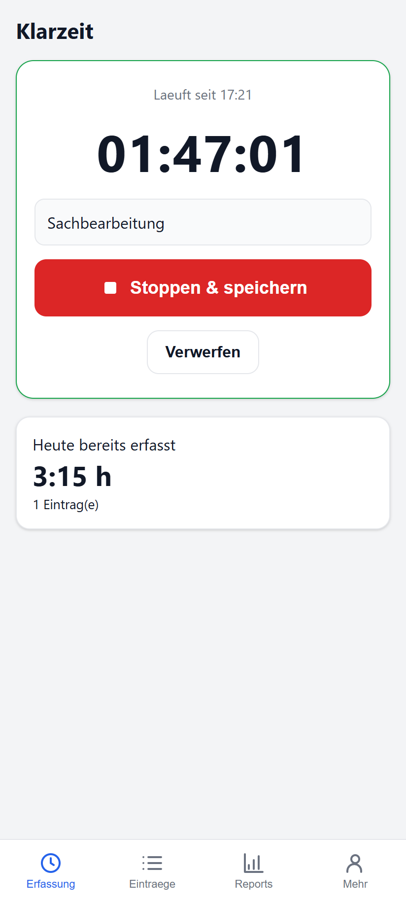
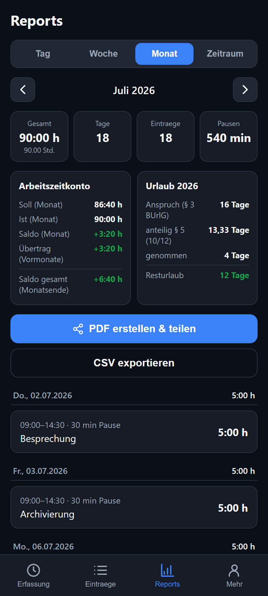
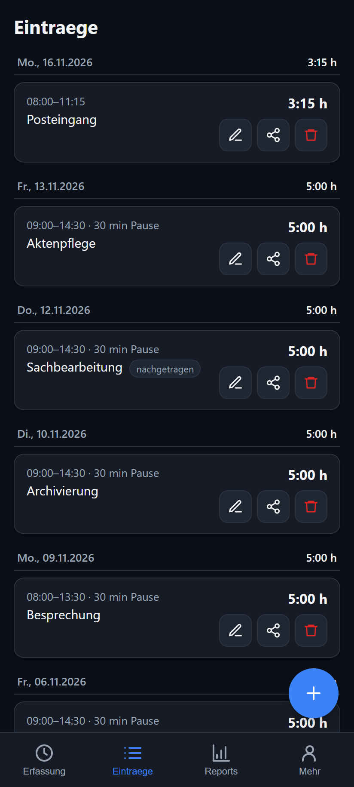
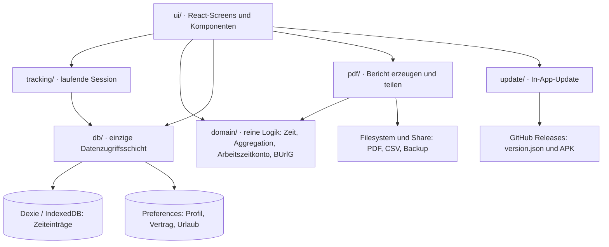

<!-- LOGO: sobald die Bilddatei vorliegt, hier einsetzen:
      -->

<div align="center">

# Klarzeit

**Deine Arbeitszeit. Dein Gerät. Sonst niemand.**

Arbeitszeiterfassung für Android, die vollständig offline arbeitet — mit
Arbeitszeitkonto und gesetzlichem Urlaub nach BUrlG.

[](LICENSE)
[](#installation)
[](https://react.dev)
[](https://www.typescriptlang.org)
[](https://capacitorjs.com)
[](#datenschutz--was-nicht-passiert)
[](https://claude.com/claude-code)

**Deutsch** · [English](README.en.md)

[APK herunterladen](https://github.com/BosslandX/klarzeit-releases/releases/latest) ·
[Screenshots](#screenshots) ·
[Arbeitszeitkonto & Urlaub](#-arbeitszeitkonto--gesetzlicher-urlaub) ·
[Wie Klarzeit entstanden ist](#wie-klarzeit-entstanden-ist)

</div>

---

## Was Klarzeit ist

Eine Stoppuhr für die Arbeitszeit, die zum vollständigen Stundennachweis wird.
Starten, stoppen, fertig — Klarzeit rechnet daraus Tages-, Wochen- und
Monatsberichte, führt ein Arbeitszeitkonto mit Soll/Ist-Saldo und ermittelt den
gesetzlichen Urlaubsanspruch nach dem Bundesurlaubsgesetz.

Ohne Konto, ohne Anmeldung, ohne Server. Die Daten liegen in der App auf dem
Gerät und verlassen es nur, wenn du selbst ein PDF, eine CSV-Datei oder ein
Backup teilst — oder wenn du für eine Beschäftigung die Übertragung an Clockodo
einschaltest und selbst auslöst.

---

## Screenshots

<table>
<tr>
<td width="50%"></td>
<td width="50%"></td>
</tr>
<tr>
<td align="center"><b>Laufende Erfassung</b><br><sub>Stoppuhr, die App-Neustarts übersteht</sub></td>
<td align="center"><b>Arbeitszeitkonto &amp; Urlaub</b><br><sub>Soll/Ist-Saldo mit Übertrag, BUrlG-Anspruch</sub></td>
</tr>
<tr>
<td width="50%"></td>
<td width="50%"></td>
</tr>
<tr>
<td align="center"><b>Berichte</b><br><sub>Tag, Woche, Monat oder freier Zeitraum</sub></td>
<td align="center"><b>Einträge</b><br><sub>Nachtragen, bearbeiten, löschen</sub></td>
</tr>
</table>

<details>
<summary>Weitere Ansichten (hell und dunkel)</summary>

| | Hell | Dunkel |
|---|---|---|
| **Erfassung** | [home-light](assets/screenshots/home-light.png) | [home-dark](assets/screenshots/home-dark.png) |
| **Laufend** | [running-light](assets/screenshots/running-light.png) | [running-dark](assets/screenshots/running-dark.png) |
| **Einträge** | [entries-light](assets/screenshots/entries-light.png) | [entries-dark](assets/screenshots/entries-dark.png) |
| **Woche** | [reports-light](assets/screenshots/reports-light.png) | [reports-dark](assets/screenshots/reports-dark.png) |
| **Monat** | [monat-light](assets/screenshots/monat-light.png) | [monat-dark](assets/screenshots/monat-dark.png) |
| **Konto & Urlaub** | [konto-light](assets/screenshots/konto-light.png) | [konto-dark](assets/screenshots/konto-dark.png) |
| **Mehr** | [more-light](assets/screenshots/more-light.png) | [more-dark](assets/screenshots/more-dark.png) |

Alle Aufnahmen zeigen **erfundene Demo-Daten** („Max Mustermann"). Sie werden mit
`node tools/screenshots.mjs` aus der laufenden App erzeugt — im Handy-Format
(412 × 915, doppelte Pixeldichte) über einen echten Chrome, aber am Schreibtisch
statt auf dem Telefon. Auf dem Gerät unterscheiden sich Systemleiste und
Safe-Area-Abstände geringfügig.

</details>

---

## Warum Klarzeit

|  | Cloud-Zeiterfassung | Tabelle | **Klarzeit** |
|---|---|---|---|
| Konto / Registrierung | nötig | – | **nicht nötig** |
| Wo die Daten liegen | fremder Server | Datei | **nur auf deinem Gerät**¹ |
| Laufende Kosten | meist monatlich | – | **keine** |
| Funktioniert ohne Netz | selten | ja | **immer** |
| Stoppuhr auf dem Handy | ja | – | **ja** |
| Arbeitszeitkonto (Soll/Ist) | teils | Handarbeit | **automatisch, fortgeschrieben** |
| Gesetzlicher Urlaub (BUrlG) | selten | Handarbeit | **berechnet, mit Paragraphenbezug** |
| PDF-Stundennachweis | ja | Handarbeit | **ja, direkt teilbar** |
| Quelloffen | selten | – | **ja, MIT** |

¹ Außer du überträgst Einträge ausdrücklich an Clockodo — siehe [Datenschutz](#datenschutz--was-nicht-passiert).

---

## Funktionen

- **Start/Stopp mit Live-Stoppuhr** — die laufende Erfassung übersteht App-Neustarts und Neustart des Geräts.
- **Tätigkeit erfassen** — beim Start eingeben oder jederzeit nachträglich ändern.
- **Manuelles Nachtragen** — vergessene Zeiten über „+" mit Datums- und Uhrzeit-Auswahl; im Bericht als nachgetragen gekennzeichnet.
- **Bearbeiten und Löschen** — Start, Ende, Pause, Tätigkeit und Notiz jedes Eintrags änderbar.
- **Pausen mit Uhrzeit** — jede Pause mit Beginn und Ende; die Pausensumme rechnet die App selbst.
- **Berichte** — je Einzeleintrag, Tag, Woche (ISO), Monat oder frei gewähltem Zeitraum, mit Summen.
- **PDF-Stundennachweis** — erzeugt und über das Android-Teilen-Menü direkt an die Mail-App.
- **CSV-Export** — Semikolon-getrennt, für deutsches Excel vorbereitet.
- **Arbeitszeitkonto** — Soll/Ist je Monat, Saldo, Übertrag aus Vormonaten, Gesamtsaldo.
- **Abgegoltene Überstunden** — sind laut Vertrag bis zu einer Zahl Überstunden im Monat mit dem Gehalt abgegolten, zählt das Konto nur das Plus darüber; Auswertung und PDF zeigen die abgegoltenen Stunden. Den Vertragshinweis unter dem Konto im PDF trägst du je Beschäftigung ein.
- **Gesetzlicher und vertraglicher Urlaub** — Jahresanspruch, Zwölftelung, Wartezeit, genommene Tage, Resturlaub.
- **Personendaten** — Name, Personalnummer, Arbeitgeber, Abteilung für den Berichtskopf.
- **Backup** — JSON-Export/-Import sowie ein automatisches Backup in den Documents-Ordner, das eine Deinstallation überlebt.
- **Clockodo-Übertragung (optional)** — je Beschäftigung einschaltbar: Kunde, Projekt und Leistung aus deinem Clockodo-Konto wählen und Einträge per Knopf übertragen, je Arbeitsabschnitt zwischen den Pausen ein Clockodo-Eintrag. Geänderte und gelöschte Einträge zieht der nächste Lauf nach.
- **In-App-Update** — prüft die GitHub-Releases dieses Repos und installiert die neue Version auf Wunsch.
- **Hell und dunkel** — folgt dem Systemdesign.

---

## ★ Arbeitszeitkonto & gesetzlicher Urlaub

Das ist der Teil, den die meisten Stoppuhr-Apps auslassen. Klarzeit rechnet ihn
aus und zeigt die Grundlage dazu.

### Arbeitszeitkonto

Aus der vertraglichen Wochenarbeitszeit ergibt sich das Monats-Soll:

```
Monats-Soll = Wochenstunden × 52 / 12
```

Bei 20 Wochenstunden also 86 h 40 min. Im Eintritts- und Austrittsmonat wird
anteilig nach Kalendertagen gerechnet. Das Ist ergibt sich aus den erfassten
Einträgen (abzüglich Pausen) und wird auf den Beschäftigungszeitraum begrenzt.
Der Saldo wird Monat für Monat fortgeschrieben:

| Monat | Soll | Ist | Saldo | Übertrag | Gesamt |
|---|---|---|---|---|---|
| Mai | 86:40 | 85:00 | −1:40 | 0:00 | −1:40 |
| Juni | 86:40 | 91:40 | +5:00 | −1:40 | +3:20 |
| Juli | 86:40 | 90:00 | +3:20 | +3:20 | **+6:40** |

**Mit dem Gehalt abgegoltene Überstunden.** Regelt dein Arbeitsvertrag, dass bis zu
einer bestimmten Zahl Überstunden im Monat mit dem Gehalt abgegolten sind, trägst du
diese Zahl je Beschäftigung ein (Tab *Mehr* → Beschäftigung *bearbeiten*). Klarzeit
zieht sie Monat für Monat vom Plus ab und schreibt nur den Rest ins Konto; Auswertung
und Monats-PDF zeigen die abgegoltenen Stunden als eigene Zeile. Jeder Monat zählt für
sich — Minusstunden aus Vormonaten mindern die Abgeltung nicht. Im Eintritts- und
Austrittsmonat gilt die Zahl anteilig, wie das Soll.

**Hinweis im PDF-Kontoblock.** Den Satz unter dem Arbeitszeitkonto im PDF — etwa die
Fundstelle der Ausgleichsregel in deinem Arbeitsvertrag — trägst du je Beschäftigung
ein; leer bleibt er weg.

### Gesetzlicher Urlaub

Der Mindesturlaub des § 3 Abs. 1 BUrlG bezieht sich auf die Sechs-Tage-Woche und
wird auf die tatsächlichen Arbeitstage umgerechnet:

```
Jahresurlaub = 24 Werktage × Arbeitstage pro Woche / 6
```

Bei 4 Arbeitstagen sind das 16 Tage. Dazu kommen die Regeln, die im Eintritts-
und Austrittsjahr greifen:

| Regel | Fundstelle | Was Klarzeit tut |
|---|---|---|
| Mindesturlaub | § 3 Abs. 1 BUrlG | 24 Werktage, auf die Arbeitstage/Woche umgerechnet |
| Wartezeit | § 4 BUrlG | voller Anspruch erst sechs Monate nach Beginn |
| Zwölftelung | § 5 Abs. 1 BUrlG | anteilig je vollem Beschäftigungsmonat |
| Ausscheiden 2. Jahreshälfte | § 5 Abs. 1 lit. c BUrlG | voller Jahresanspruch statt Zwölftelung |
| Rundung | § 5 Abs. 2 BUrlG | Bruchteile ab einem halben Tag auf volle Tage **auf**; kleinere Bruchteile bleiben erhalten (sie werden **nicht** abgerundet) |

Die Rundungsregel ist die, die am häufigsten falsch gemacht wird: § 5 Abs. 2
kennt nur das Aufrunden. Ein Anspruch von 13,33 Tagen bleibt 13,33 Tage — er
wird nicht auf 13 abgerundet.

**Vertraglicher Urlaub.** Gewährt dein Arbeitsvertrag mehr als das gesetzliche
Minimum, trägst du den Jahresurlaub je Beschäftigung ein (Tab *Mehr* →
Beschäftigung *bearbeiten* → „Urlaubsanspruch laut Vertrag"). Klarzeit rechnet
dann mit diesem Wert, nie aber mit weniger als dem gesetzlichen Minimum.
Wartezeit, Zwölftelung und Rundung gelten für den ganzen Anspruch.

<details>
<summary><b>Rechtsgrundlagen im Detail</b></summary>

Die Berechnung stützt sich auf das
[Bundesurlaubsgesetz](https://www.gesetze-im-internet.de/burlg/) in der Fassung,
die dort veröffentlicht ist. Die Umsetzung liegt vollständig in
[`src/domain/employment.ts`](src/domain/employment.ts) und ist frei von
UI- und Datenbankcode, damit sie prüfbar bleibt.

**Was die Berechnung nicht leistet:**

- **Keine Feiertage und keine Krankheitstage.** Klarzeit kennt nur erfasste
  Arbeitszeit und selbst eingetragene Urlaubstage.
- **Keine eigenen Regeln für Mehrurlaub.** Den vertraglichen oder tariflichen
  Jahresurlaub trägst du als Zahl ein; Klarzeit wendet darauf die gesetzlichen
  Regeln an. Sieht dein Vertrag für den Mehrurlaub etwas anderes vor, weicht die
  Anzeige im Eintritts- und Austrittsjahr ab.
- **Kein Schwerbehindertenzusatzurlaub** (§ 208 SGB IX).
- **Keine Übertragung ins Folgejahr** (§ 7 Abs. 3 BUrlG) — der Resturlaub wird je
  Kalenderjahr ausgewiesen, nicht fortgeschrieben.
- **Keine Mitternachtsteilung.** Ein Eintrag zählt vollständig zu dem Tag, an dem
  er beginnt (Stundenzettel-Konvention). Bei Nachtschichten ist das zu beachten.

Die Rechenwege sind in
[`src/domain/employment.test.ts`](src/domain/employment.test.ts) mit 67 Tests
belegt, die die Paragraphen einzeln durchgehen.

</details>

---

## Datenschutz — was *nicht* passiert

Klarzeit verarbeitet Arbeitszeiten und Personendaten. Beides bleibt lokal — außer
du schaltest die Übertragung an Clockodo ein.

- **Kein Konto, keine Anmeldung, keine Nutzerkennung.**
- **Kein Analytics, kein Crash-Reporting, keine Werbe-IDs, keine Tracker.**
- **Keine Datenübertragung im Betrieb, außer auf deinen Wunsch.** Die einzige
  Netzverbindung, die die App
  von sich aus aufbaut, ist der Update-Check gegen die GitHub-Releases dieses
  Repos — und den stößt du im Tab „Mehr" selbst an.
- **Clockodo nur, wenn du es einschaltest.** Schaltest du bei einer Beschäftigung
  die Übertragung an Clockodo ein, sendet die App deren Einträge (Zeiten, Pausen als
  Lücken, Tätigkeit, Kunde, Projekt, Leistung) an dein Clockodo-Konto — und zwar nur,
  wenn du „An Clockodo uebertragen“ tippst. Der API-Schlüssel liegt verschlüsselt im
  Android-Schlüsselspeicher, ist von Google-Backup und Geräteumzug ausgenommen und
  steht in keinem Klarzeit-Backup.
- **Weitergabe nur durch dich.** PDF, CSV und Backup verlassen das Gerät
  ausschließlich über das Teilen-Menü, das du bedienst.

### Warum die App diese Berechtigungen anfordert

| Berechtigung | Wofür | Anmerkung |
|---|---|---|
| `INTERNET` | Update-Prüfung und Download der neuen APK; Übertragung an Clockodo, wenn eingeschaltet | nur bei manuell ausgelöster Update-Prüfung bzw. Übertragung |
| `WRITE_EXTERNAL_STORAGE` | automatisches Backup nach `Documents/Klarzeit/` | nur bis Android 10 (`maxSdkVersion=29`); ab Android 11 schreibt die App ihre eigenen Dateien ohne Berechtigung |
| `REQUEST_INSTALL_PACKAGES` | Start des System-Installers für das In-App-Update | öffnet nur den Android-Dialog; die Installation bestätigst du |

Gespeichert wird in IndexedDB (Zeiteinträge) und in den App-Preferences (Profil,
Vertragsdaten, Urlaubstage) — beides im app-privaten Bereich des Geräts. Den
Clockodo-Schlüssel verwahrt getrennt davon der Android-Schlüsselspeicher (KeyStore).

---

## Architektur



Zwei Regeln halten das zusammen:

1. **`domain/` ist rein.** Keine Datenbank, kein React, keine Capacitor-Aufrufe —
   nur Funktionen über Werten. Deshalb ist die Rechtsmathematik testbar.
2. **`db/` ist die einzige Stelle, die Daten liest oder schreibt.** Zeiten immer
   als Epoch-Millisekunden; formatiert wird ausschließlich in `domain/time.ts`.

<details>
<summary><b>Verzeichnisstruktur</b></summary>

```
src/
  domain/     types · time (Dauer/Format) · aggregate (Tag/Woche/Monat)
              employment (Arbeitszeitkonto + BUrlG) · employment.test
  db/         db (Dexie) · entries · profile · running · employment
              backup · auto-backup
  tracking/   useTracker (laufende Session)
  pdf/        report-pdf (jsPDF) · share (Filesystem + Share)
  update/     updater (GitHub Releases via CapacitorHttp)
  ui/         App · styles.css
              components/  BottomNav · EntryFormModal · Icons
              screens/     Home · Entries · Reports · More
android/      Capacitor-Projekt, inkl. nativem ApkInstaller-Plugin
tools/        gen-icons · optimize-png · gradle · screenshots
assets/       Logo-Quellen und Screenshots
```

</details>

---

## Installation

Klarzeit liegt nicht im Play Store. Die signierte APK gibt es unter
[Releases](https://github.com/BosslandX/klarzeit-releases/releases/latest).

1. APK herunterladen.
2. Android fragt beim Öffnen nach der Erlaubnis, Apps aus dieser Quelle zu
   installieren — bestätigen.
3. Installieren, fertig. Ab dann meldet sich die App selbst, wenn im Tab „Mehr"
   eine neue Version gefunden wird.

> **Umstieg von einer früheren Version mit anderer App-ID:** Android behandelt
> eine geänderte App-ID als eigenständige App. Exportiere vorher im Tab „Mehr"
> ein Backup, installiere Klarzeit, importiere das Backup und deinstalliere dann
> die alte App. Das Backup-Format ist bewusst kompatibel geblieben.

<details>
<summary><b>Selbst bauen</b></summary>

**Voraussetzungen:** Node 20+, JDK 21 (`JAVA_HOME` gesetzt), Android SDK.
Den SDK-Pfad in `android/local.properties` eintragen:

```properties
sdk.dir=/pfad/zum/Android/Sdk
```

```bash
npm install
npm run dev          # Web-Version im Browser (Daten in IndexedDB)
npm test             # Domain-Tests (Arbeitszeitkonto, BUrlG)
npm run build        # TypeScript-Prüfung + Vite-Build nach dist/
npm run apk          # Debug-APK
```

Ergebnis: `android/app/build/outputs/apk/debug/klarzeit-1.3-debug.apk`

**Signierte Release-APK.** Das Signing liest seine Zugangsdaten aus der
gitignorierten `android/keystore.properties`; fehlt sie, wird unsigniert gebaut,
statt den Build abzubrechen.

```bash
keytool -genkeypair -v -keystore android/klarzeit-release.keystore \
  -alias klarzeit -keyalg RSA -keysize 2048 -validity 10000
cp android/keystore.properties.example android/keystore.properties
# Werte eintragen, dann:
npm run apk:release
```

> Keystore und Passwort sicher aufbewahren. Beides wird gebraucht, um die App
> später mit derselben Signatur zu aktualisieren; ein Verlust lässt sich nicht
> rückgängig machen — Nutzer müssten neu installieren.

**Icons und Splash** werden aus `assets/source-logo.png` erzeugt:

```bash
npm run icons
```

</details>

<details>
<summary><b>Eine neue Version veröffentlichen</b></summary>

1. `versionCode` (aufsteigend) und `versionName` in `android/app/build.gradle` setzen,
   dazu `version` in `package.json` (daraus liest die App ihre Versionsanzeige).
2. `npm test && npm run build`, dann `npm run apk:release`.
3. Signatur prüfen: `apksigner verify --print-certs <apk>`.
4. `version.json` schreiben — `versionCode` muss zur `build.gradle` passen, `url` ist die
   Tag-URL mit dem versionierten Dateinamen:

```json
{
  "versionCode": 7,
  "versionName": "1.5.1",
  "url": "https://github.com/BosslandX/klarzeit-releases/releases/download/v1.5.1/klarzeit-1.5.1-release.apk",
  "notes": "Was neu ist"
}
```

5. Release im öffentlichen Release-Repo anlegen und beide Dateien anhängen:

```bash
gh release create v1.5.1 -R BosslandX/klarzeit-releases \
  --title "Klarzeit 1.5.1" --notes "Was neu ist" \
  klarzeit-1.5.1-release.apk version.json
```

Der Updater liest `releases/latest/download/version.json` aus
[`BosslandX/klarzeit-releases`](https://github.com/BosslandX/klarzeit-releases) — einem
öffentlichen Repo, das nur Releases trägt. Er fragt über `CapacitorHttp` ab (nicht über
`fetch` — der GitHub-Asset-Server sendet keine CORS-Header). Ein Update wird nur
installiert, wenn App-ID **und** Signatur übereinstimmen.

</details>

<details>
<summary><b>Versionshistorie</b></summary>

**1.3** — Veröffentlichung als quelloffenes Projekt unter dem Namen Klarzeit.
Neue App-ID `io.github.bosslandx.klarzeit`, Update-Bezug aus diesem Repo, MIT-Lizenz.

**1.2** — Arbeitszeitkonto (Soll/Ist-Saldo mit Übertrag) und gesetzlicher Urlaub
nach BUrlG in Monatsberichten und Monats-PDF. Backup-Format Version 2 sichert
Vertragsdaten und Urlaubstage mit; ältere Backups bleiben lesbar.

**1.1** — Automatisches Backup in den Documents-Ordner, das eine Deinstallation
übersteht. In-App-Update über GitHub-Releases. Icon und Splash-Screen.

**1.0** — Erfassung mit Live-Stoppuhr, manuelles Nachtragen, Bearbeiten und
Löschen, Berichte über Tag/Woche/Monat/Zeitraum, PDF- und CSV-Export,
JSON-Backup, Personendaten.

</details>

---

## Wie Klarzeit entstanden ist

Klarzeit ist im Pair-Programming mit **[Claude Code](https://claude.com/claude-code)**
(Anthropic) entstanden — nicht als „einmal generieren lassen", sondern als
Verfahren mit Prüfschritten:

| Phase | Was passiert ist |
|---|---|
| **Rechtslogik zuerst** | Arbeitszeitkonto und BUrlG-Berechnung testgetrieben: erst die Testfälle je Paragraph, dann die Implementierung. Heute 67 Tests. |
| **Review-Durchgang 1** | Adversariale Mehrdimensions-Review des Gesamtcodes durch 26 Agenten. 16 Befunde bestätigt, 6 nach Gegenprüfung verworfen. |
| **Review-Durchgang 2** | Vier Dimensionen plus Gegenprüfung durch 19 Agenten, gezielt auf Arbeitszeitkonto und Urlaub. 12 Befunde, alle behoben. |
| **Gegenprüfung** | Jeder Befund musste widerlegbar sein. Was der Gegenprüfung nicht standhielt, wurde verworfen statt „sicherheitshalber" gefixt. |

Gefunden und behoben wurden dabei unter anderem: ein nicht-atomarer
Backup-Restore, der bei einer fehlerhaften Datei alle Daten hätte verlieren
können; eine falsche Zwölftelung beim Ausscheiden in der zweiten Jahreshälfte;
eine Verwechslung von Auf- und Abrunden bei § 5 Abs. 2; eine Race Condition
zwischen Berichtstabelle und Arbeitszeitkonto im PDF; und eine
Off-by-one-Verschiebung, weil `type=date` als UTC statt lokal gelesen wurde.

**Was bewusst offen blieb:** `npm audit` meldet drei Schwachstellen in
`dompurify`, das über `jspdf` hereinkommt. Der betroffene Pfad wird zur Laufzeit
nie geladen — die App nutzt nur `autoTable` und `text`, nie `jsPDF.html()`. Ein
Fix erfordert `jspdf@4` mit brechender API-Änderung und ist zurückgestellt.
Lieber so benannt als stillschweigend übergangen.

Beiträge von Claude sind in der Versionsgeschichte als
`Co-Authored-By: Claude <noreply@anthropic.com>` gekennzeichnet.

---

## Haftungsausschluss

Klarzeit rechnet Arbeitszeitsalden und den gesetzlichen Mindesturlaub aus. Diese
Zahlen sind **keine Rechtsberatung** und ohne Gewähr. Maßgeblich sind dein
Arbeitsvertrag, ein etwaiger Tarifvertrag und die geltenden Gesetze — im
Zweifelsfall frag deinen Arbeitgeber, den Betriebsrat oder eine
Rechtsberatung. Prüfe deinen Stundennachweis, bevor du ihn einreichst.

Für Datenverlust wird nicht gehaftet. Nutze die Backup-Funktion.

---

## Lizenz

[MIT](LICENSE) — Copyright © 2026 Zwetan Letschew.

Nutzung, Änderung und Weitergabe sind erlaubt, auch kommerziell, solange der
Copyright-Hinweis erhalten bleibt.

## Credits

Entwickelt von **Zwetan Letschew** im Pair-Programming mit
**[Claude Code](https://claude.com/claude-code)** (Anthropic).

Getragen von: [React](https://react.dev) · [Vite](https://vite.dev) ·
[Capacitor](https://capacitorjs.com) · [Dexie](https://dexie.org) ·
[jsPDF](https://github.com/parallax/jsPDF) ·
[jspdf-autotable](https://github.com/simonbengtsson/jsPDF-AutoTable) ·
[date-fns](https://date-fns.org)
